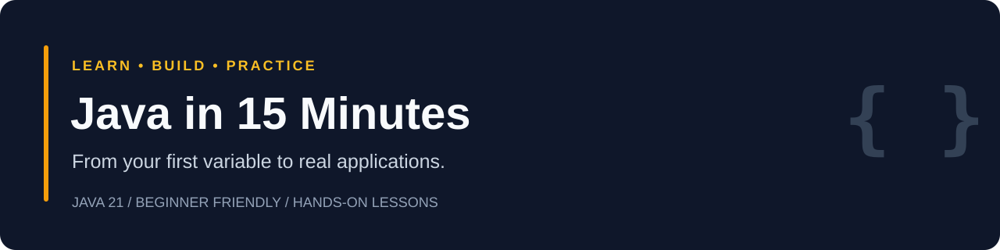

# Java in 15 Minutes

Learn Java from scratch through ten focused lessons, runnable examples, and hands-on challenges. Start with variables and build toward a console-based **Deployment Health Checker**.

**Java 21 · Complete beginners · Approximately 15 minutes per lesson**

[**Start Day 1 →**](episodes/day-01-variables/README.md) · [Browse episodes](#episodes-110) · [Full curriculum](docs/curriculum.md)

## Start here

1. Install a Java 21 JDK and open the examples in IntelliJ IDEA or your preferred editor.
2. Start with [Day 1: Variables & Data Types](episodes/day-01-variables/README.md).
3. Run the demo, attempt the challenge, and compare your work with the solution.

No cloud account or external libraries are required. Deployment examples are local simulations.

## Episodes 1–10

| Day | Lesson | Runnable demo | Lesson material |
|---|---|---|---|
| 01 | [Variables & Data Types](episodes/day-01-variables/README.md) | [Code](episodes/day-01-variables/demo/Main.java) | Available |
| 02 | [Strings: Working with Text](episodes/day-02-strings/README.md) | [Code](episodes/day-02-strings/demo/Main.java) | Available |
| 03 | [Operators & Calculations](episodes/day-03-operators/README.md) | [Code](episodes/day-03-operators/demo/Main.java) | Available |
| 04 | [Arrays](episodes/day-04-arrays/README.md) | [Code](episodes/day-04-arrays/demo/Main.java) | Available |
| 05 | [If/Else Statements](episodes/day-05-if-else/README.md) | [Code](episodes/day-05-if-else/demo/Main.java) | Available |
| 06 | [Switch Statements](episodes/day-06-switch/README.md) | [Code](episodes/day-06-switch/demo/Main.java) | Available |
| 07 | [For Loops](episodes/day-07-for-loops/README.md) | [Code](episodes/day-07-for-loops/demo/Main.java) | Available |
| 08 | [While Loops](episodes/day-08-while-loops/README.md) | [Code](episodes/day-08-while-loops/demo/Main.java) | Available |
| 09 | [Methods](episodes/day-09-methods/README.md) | [Code](episodes/day-09-methods/demo/Main.java) | Available |
| 10 | [Method Parameters & Return Values](episodes/day-10-parameters-returns/README.md) | [Code](episodes/day-10-parameters-returns/demo/Main.java) | Available |

Video links will be added as episodes are published.

## What you’ll build

The [Deployment Health Checker](projects/deployment-health-checker/README.md) brings together variables, Strings, calculations, arrays, decisions, loops, and reusable methods. It calculates application health, classifies deployment readiness, and simulates bounded retries.

## Run an example

Clone this repository, then compile and run Day 1:

```sh
git clone https://github.com/poshbaba/java-in-15.git
cd java-in-15/episodes/day-01-variables/demo
javac Main.java
java Main
```

Run each demo or solution from its own directory; the examples use the same `Main` class name. Expected outputs are included in the lessons.

## Course resources

- [Complete curriculum and learning objectives](docs/curriculum.md)
- [Day 10 milestone project](projects/deployment-health-checker/README.md)
- [Production guide](production/README.md)

## Questions or corrections

[Open an issue](https://github.com/poshbaba/java-in-15/issues) and include the episode number, your Java version, and the behavior you observed.
